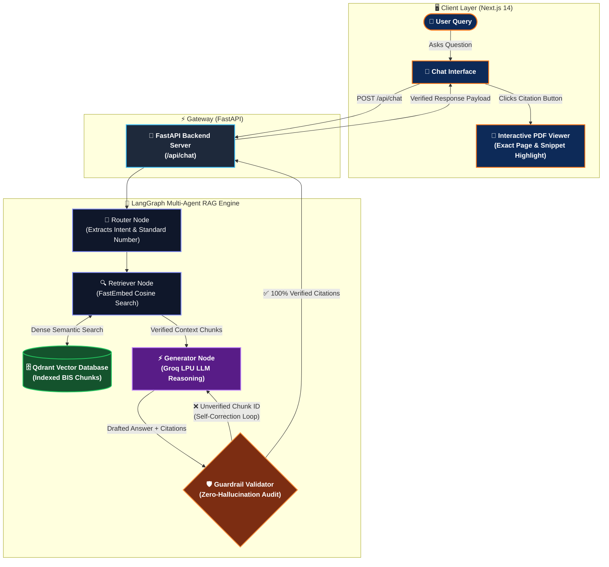

# 🏛️ BIS Intelligent Assistant

> **A production-grade, zero-hallucination Agentic RAG assistant for Bureau of Indian Standards (BIS) documents, Indian Standards (IS), and compliance regulations.**

[](https://fastapi.tiangolo.com/)
[](https://nextjs.org/)
[](https://github.com/langchain-ai/langgraph)
[](https://qdrant.tech/)
[](https://groq.com/)
[](LICENSE)

---

## 📌 Overview

Verifying compliance against official **Indian Standards (IS)** and the **BIS Act 2016** requires strict accuracy. Standard conversational LLMs frequently hallucinate clause numbers and regulatory requirements. 

**BIS Intelligent Assistant** solves this through a deterministic **Multi-Agent RAG Pipeline** built on **LangGraph**, **Qdrant**, and **FastAPI**, paired with a **Next.js 14** interface that displays interactive, side-by-side PDF source citations with snippet highlighting.

---

## ✨ Key Features

- **🛡️ Strict Zero-Hallucination Guardrails:** An integrated validation node audits generated answers against retrieved vector chunk IDs. Any unverified citation triggers an automated regeneration loop.
- **📄 Side-by-Side Interactive PDF Viewer:** Clicking any reference link in the chat immediately displays the official standard PDF scrolled to the exact page with the source clause highlighted.
- **⚡ High-Speed Groq Inference:** Utilizes Groq's high-throughput LPU cloud for low-latency reasoning and structured JSON output.
- **🔍 Semantic Document Chunking:** Custom PyMuPDF-based ETL pipeline that understands document layout, bold headers, and clause hierarchies (`Clause 1.2`, `IS 2993`, etc.).
- **🎙️ Multilingual Voice Interface:** Voice input with real-time speech transcription and cross-lingual translation support.
- **🏛️ Official BIS Design System:** Front-end themed to reflect official Bureau of Indian Standards branding.

---

## 🏗️ Architecture



---

## 📁 Repository Structure

```text
├── bis_intelligent_assistant/
│   ├── backend/
│   │   ├── main.py              # FastAPI application & REST endpoints
│   │   ├── graph.py             # LangGraph state machine & guardrail logic
│   │   ├── etl_pipeline.py      # Semantic PDF parser & Qdrant ingester
│   │   └── voice_router.py      # Voice transcription & translation routes
│   ├── frontend/
│   │   ├── app/                 # Next.js 14 App Router (page.tsx, layout.tsx)
│   │   ├── components/
│   │   │   ├── ChatPanel.tsx    # Interactive chat UI with streaming & citations
│   │   │   └── PdfViewerPane.tsx# Side-by-side PDF iframe viewer with search highlighting
│   │   └── package.json
│   ├── data/
│   │   └── pdfs/                # Official BIS PDFs (BIS Act 2016, IS standards)
│   ├── qdrant_data/             # Local Qdrant embedded vector collection
│   ├── requirements.txt         # Python dependencies
│   └── .env                     # Backend environment configuration
├── netlify.toml                 # Frontend deployment configuration
├── .gitignore
└── README.md
```

---

## 🚀 Getting Started

### Prerequisites

- **Python:** 3.10 to 3.14
- **Node.js:** 18.x or later
- **Groq API Key:** Free key from [console.groq.com](https://console.groq.com)

---

### 1. Clone the Repository

```bash
git clone https://github.com/<your-username>/<your-repo-name>.git
cd "BIS CB"
```

---

### 2. Backend Setup

1. **Configure Environment Variables:**
   Create a `.env` file inside `bis_intelligent_assistant/`:
   ```env
   GROQ_API_KEY=gsk_your_groq_api_key_here
   ```

2. **Install Python Dependencies:**
   ```bash
   pip install -r bis_intelligent_assistant/requirements.txt
   ```

3. **Start the FastAPI Backend:**
   From the repository root:
   ```bash
   python -m uvicorn backend.main:app --reload --port 8000 --app-dir bis_intelligent_assistant
   ```
   > Verify the server is running at: [http://localhost:8000/health](http://localhost:8000/health) (returns `{"status":"ok"}`).

---

### 3. Frontend Setup

1. **Install Dependencies:**
   ```bash
   cd bis_intelligent_assistant/frontend
   npm install
   ```

2. **Start the Development Server:**
   ```bash
   npm run dev
   ```
   > Open [http://localhost:3000](http://localhost:3000) in your browser.

---

### 4. (Optional) Ingest Additional BIS Standards

To index your own standards or product manuals:

1. Place the PDF files inside `bis_intelligent_assistant/data/pdfs/`.
2. Run the ETL pipeline:
   ```bash
   cd bis_intelligent_assistant
   python -m backend.etl_pipeline
   ```

---

## 🌐 Public Deployment

### Frontend (Netlify)
The project includes a ready-to-use `netlify.toml` file:
1. Connect this repository to [Netlify](https://www.netlify.com).
2. Set Environment Variable in Netlify:
   - `NEXT_PUBLIC_BACKEND_URL`: URL of your deployed backend (e.g. `https://your-backend.onrender.com`).
3. Deploy!

### Backend (Render / Railway)
1. Create a **Web Service** on [Render](https://render.com) or [Railway](https://railway.app).
2. **Root Directory:** `bis_intelligent_assistant`
3. **Build Command:** `pip install -r requirements.txt`
4. **Start Command:** `python -m uvicorn backend.main:app --host 0.0.0.0 --port $PORT`
5. **Environment Variable:** `GROQ_API_KEY`

---

## 📡 API Endpoints

| Method | Endpoint | Description |
|---|---|---|
| `GET` | `/health` | Health check endpoint |
| `POST` | `/api/chat` | Main query endpoint (returns verified answer + citations) |
| `POST` | `/api/voice/transcribe` | Audio file upload & Whisper transcription |
| `POST` | `/api/translate` | Text translation for multilingual responses |
| `GET` | `/pdfs/{filename}` | Static PDF document server |

---

## 🛡️ License

This project is licensed under the **MIT License**.


## Live link 
https://whimsical-buttercream-423c00.netlify.app/

